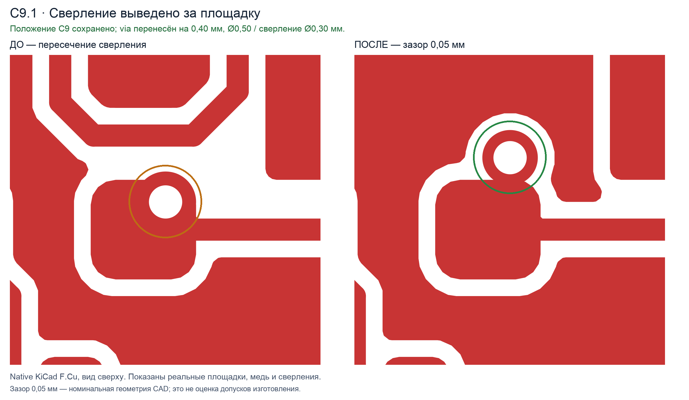
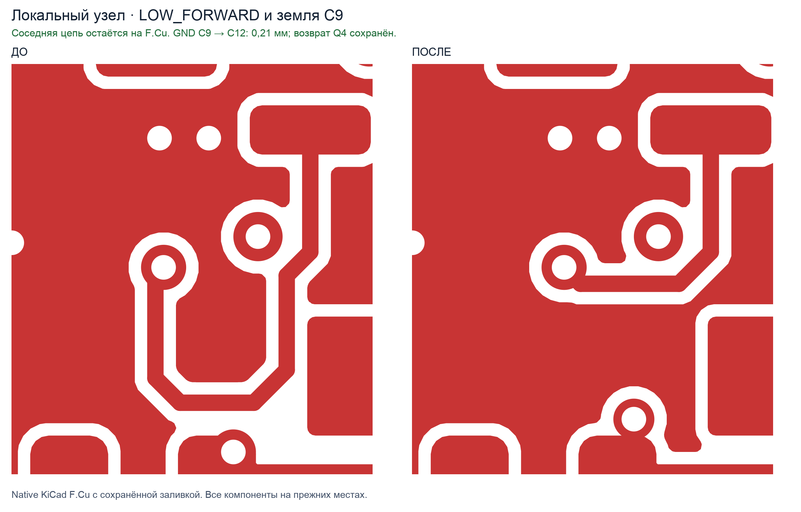

# PCB_mastering_by_DM

[Русский](README.md) · English

**[Download the v2.1.1 ZIP](https://github.com/utowarerumono-arch/PCB_mastering_by_DM/releases/download/v2.1.1/pcb-mastering-by-dm-v2.1.1-public.zip)**

This Codex skill helps review and format electronic schematics, compare design revisions, and verify PCB changes. It supports KiCad workflows and can review Altium designs through an available editor or documented exports.

The skill grew out of the work of **Dmitry Maksimovich, the technical lead for the engineering workstream**. His schematics, board layouts, and review comments provided the basis for comparison. Dmitry Maksimovich personally corrected the errors found during the work. His reviews and subsequent test runs informed changes to the instructions and added checks to catch similar omissions in later revisions.

## How the skill evolved

1. **Comparing revisions and imports.** The work began by comparing schematic and board revisions. The reviews recorded changes to connections and pins, identified import defects, and checked disputed findings against native CAD files and component documentation.
2. **Reviewing circuits and recording decisions.** The reviews led to a repeatable process for defining the scope of work, distinguishing agreed requirements from the current CAD implementation, and recording the source of each material finding. The process also checks how schematic changes affect signal behavior and accounts for manufacturing constraints before routing.
3. **Checking board geometry.** Local layout fixes helped refine the checks for trace shape, actual copper widths and drill diameters, drill overlaps with SMD pads, and preservation of nearby return paths. The two renders below show examples before and after the fixes.
4. **Testing the workflow with scenarios.** Repeat runs clarified what the final review should record. Version **2.1.1** explicitly checks closed loops and their purpose, actual drill sizes after saving the board, and the contents of the native CAD handoff. When comparing revisions, the skill calls for recording file hashes so that reports and renders can be tied to the revision that was checked.

The public edition contains general rules, local examples, geometry review scenarios, and an evidence integrity checker. Dimensions, stackup, and current requirements come from the task brief and the profile for the board being reviewed.

## Install in Codex

From the downloaded repository, copy the [entire skill directory](skills/PCB_mastering_by_DM) into `~/.agents/skills/`. When updating, replace the previous copy in full. For a project-only installation, use that project's `.agents/skills/` directory.

Mention `$PCB_mastering_by_DM` in your Codex prompt. Restart Codex if the skill does not appear in the list. [OpenAI documentation on skills](https://learn.chatgpt.com/docs/build-skills#where-codex-loads-local-skills)

> Apply $PCB_mastering_by_DM to a copy of the board. Check trace geometry, drill overlaps with SMD pads, and whether the DRC results apply to this revision. List the input files and the status of each check.

## Examples

### Drill clearance at an SMD pad

These top views of KiCad's `F.Cu` layer show a drill overlapping a pad on the left and clearing it after the via was moved on the right. The white circle is the hole and the surrounding copper forms the annular ring. The shown 0.05 mm clearance is nominal CAD geometry. Whether that clearance is manufacturable depends on the board shop's tolerances.



### Local rerouting and copper fill

In this `F.Cu` detail, the trace on the left takes a long detour. On the right, it connects the same visible points along a shorter route. Both views show the board after copper zones were filled. A change like this also calls for checking the affected connections and return paths.



## Verification

Run the tests from the repository root with Python 3. They require no third-party packages.

```sh
python3 -m unittest discover -s skills/PCB_mastering_by_DM/tests -p 'test_*.py' -v
```

The `check_evidence.py` script checks file hashes and whether recorded checks refer to the stated files. Run ERC, DRC, and other task-specific checks in CAD to verify the schematic and board. [Manifest format and review scenarios](skills/PCB_mastering_by_DM/tests/README.md)

## License

The skill, scripts, and written documentation are distributed under the [MIT License](LICENSE).

The PNG renders in `examples/` are provided for demonstration only and have [separate terms of use](examples/README.md).
