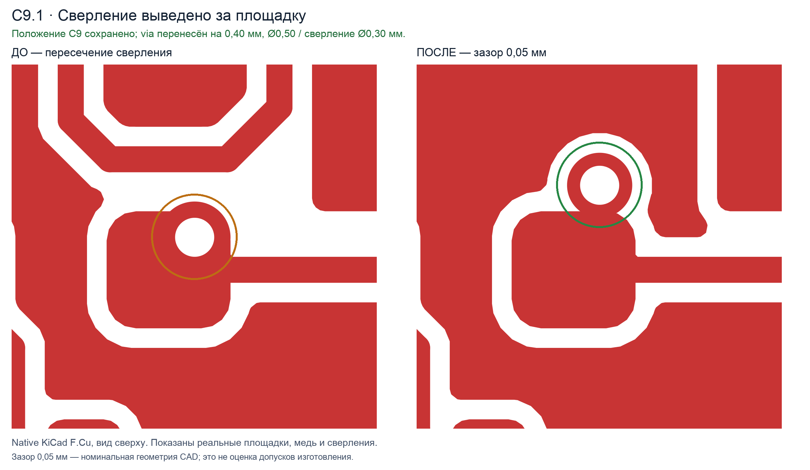
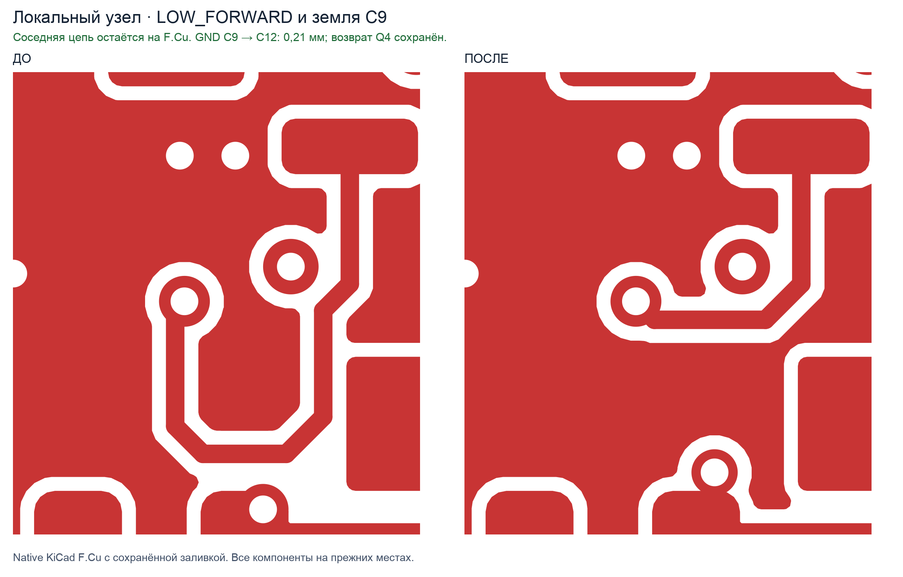

# PCB_mastering_by_DM

Русский · [English](README.en.md)

**[Скачать ZIP релиза v2.1.1](https://github.com/utowarerumono-arch/PCB_mastering_by_DM/releases/download/v2.1.1/pcb-mastering-by-dm-v2.1.1-public.zip)**

Скил для Codex помогает разбирать и оформлять электрические схемы, сравнивать ревизии и проверять изменения печатных плат. Он рассчитан на работу с KiCad и на разбор проектов Altium через доступный редактор или документированные экспорты.

Скил вырос на работах **Дмитрия Максимовича, технического руководителя поднаправления**. Его схемы, платы и замечания послужили материалом для сравнения, и именно Дмитрий Максимович корректировал ошибки, выявленные в ходе работы. По его разбору и результатам последующих прогонов уточняли инструкции и добавляли проверки, чтобы похожие пропуски можно было обнаружить в следующих ревизиях.

## Как развивался скил

1. **Сравнение ревизий и импортов.** Начали со сравнения вариантов схемы и платы. Фиксировали изменения в соединениях и выводах, отделяли дефекты импорта от инженерных решений и сверяли спорные места с исходными файлами CAD и документацией на компоненты.
2. **Разбор схемы и фиксация решений.** Из ревью вырос порядок работы с проектом: определить границы задачи, отделить согласованные требования от текущего состояния CAD и указывать источник каждого существенного вывода. Отдельно стали проверять поведение сигналов при изменениях схемы и учитывать производственные ограничения до трассировки.
3. **Проверка геометрии платы.** На локальных правках уточнили, как проверять форму дорожек, фактическую ширину меди и диаметр сверлений, пересечения отверстий с SMD-площадками и сохранность соседних возвратных путей. Два рендера ниже показывают такие правки до и после.
4. **Проверка результата по сценариям.** При повторных прогонах уточнили, какие сведения должны попадать в результат. В версии **2.1.1** явно проверяются замкнутые петли и их назначение, фактические отверстия после сохранения платы и состав комплекта исходных файлов CAD. Для сравнения ревизий скил требует фиксировать файлы и их хеши, чтобы отчёт и рендер относились к проверенной версии.

В публичной редакции собраны общие правила, локальные примеры, сценарии проверки геометрии и скрипт проверки целостности доказательств. Требования к конкретной плате, включая размеры, стек и токи, берутся из задания и профиля проекта.

## Установка в Codex

Из корня скачанного репозитория скопируйте [всю папку скила](skills/PCB_mastering_by_DM) в `~/.agents/skills/`. При обновлении замените прежнюю копию целиком. Для установки в одном проекте используйте каталог `.agents/skills/` этого проекта.

Укажите `$PCB_mastering_by_DM` в запросе к Codex. Если скил не появился в списке, перезапустите Codex. [Документация OpenAI по скилам](https://learn.chatgpt.com/docs/build-skills#where-codex-loads-local-skills)

> Примени $PCB_mastering_by_DM к копии платы. Проверь форму трасс, пересечения сверлений с SMD-площадками и свежесть результатов DRC. Укажи входные файлы и статус каждой проверки.

## Демонстраторы

### Сверление рядом с SMD-площадкой

На фрагменте верхнего слоя KiCad (`F.Cu`, вид сверху) слева сверление пересекает площадку, справа после переноса via отверстие находится за её границей. Белый круг показывает отверстие, медь вокруг него образует контактное кольцо. Указанные 0,05 мм относятся к номинальной геометрии этого фрагмента. Допустимость зазора при изготовлении зависит от допусков выбранного производства.



### Локальная форма дорожки и заливка

На другом фрагменте `F.Cu` слева видна дорожка с длинным обходом, справа она соединяет те же видимые точки по более короткому маршруту. Оба изображения показывают медь после заливки. При такой правке отдельно проверяют затронутые соединения и пути возвратного тока.



## Проверка

Из корня репозитория запустите тесты на Python 3. Сторонние пакеты не требуются.

```sh
python3 -m unittest discover -s skills/PCB_mastering_by_DM/tests -p 'test_*.py' -v
```

Скрипт `check_evidence.py` проверяет хеши и привязку заявленных проверок к файлам. Для проверки схемы и платы запускайте ERC, DRC и другие проверки по заданию в CAD. [Формат манифеста и сценарии проверки](skills/PCB_mastering_by_DM/tests/README.md)

## Лицензия

Скил, скрипты и текстовая документация распространяются по [лицензии MIT](LICENSE).

PNG-рендеры в `examples/` опубликованы только для демонстрации. На них распространяются [отдельные условия](examples/README.md).
